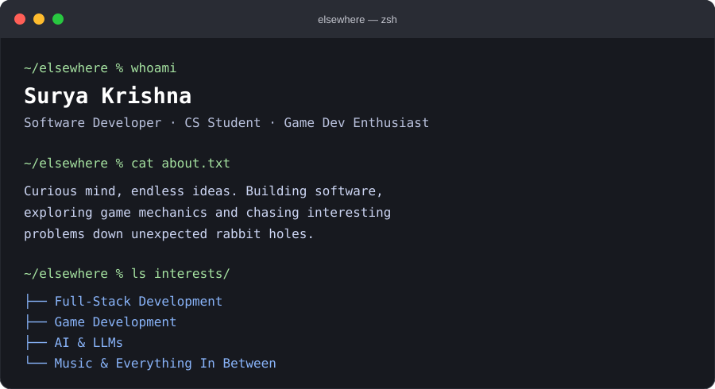

 

# Hey, I'm Surya Krishna 👋

### `> I build. I break. I figure things out.`

**Software Developer | Computer Science Student | Game Development Enthusiast**

I enjoy turning random ideas into working products, exploring how systems work under the hood, and building things that solve actual problems. Passionate about software engineering, game development, and experimenting with emerging technologies.

---

## ⚡ About Me

  

## 🚀 Featured Projects

### 🎮 Project Phoenix
**CTF Challenge & Game Design**

A cyberpunk-themed challenge experience designed around problem-solving, exploration and technical challenges.

- Designed multi-stage challenge experiences.
- Explored web exploitation and vulnerability mechanics.
- Worked on challenge infrastructure and Docker-based environments.
- Combined game design principles with technical problem-solving.

### 🎵 BeatWrap
**Your music, turned into insights.**

A Spotify-powered application that transforms listening history into personalized weekly insights.

- Built using React Native and Expo.
- Integrated Spotify Web API with PKCE authentication.
- Generated personalized music insights and playlists.
- Used LLMs through Groq to assign movie characters based on listening patterns.

---

## 🛠️ Tech Stack

**Languages**

**Frontend & Mobile**

**Backend & Databases**

**Tools & Technologies**

---

## 🧠 Areas of Interest

| Area | What interests me |
|---|---|
| Full-Stack Development | Building applications end to end |
| Game Development | Game mechanics, interactive worlds and gameplay systems |
| AI Engineering | LLMs, AI integrations and intelligent applications |
| Systems & Backend | APIs, databases, networking and architecture |
| Problem Solving | DSA, algorithms and competitive challenges |
| Cybersecurity | CTFs, web exploitation and vulnerability research |

---

## 🏆 Beyond Coding

- Participated in hackathons and technical competitions.
- Explored attack-defense CTF environments.
- Worked on designing technical challenges and game-based experiences.
- Enjoy experimenting with new technologies and turning ideas into projects.

---

## 📊 GitHub Statistics

---

## 🤝 Let's Connect

---

*"Fueled by coffee, driven by curiosity, and permanently stuck on the next track."*

— Surya, probably at 3 AM ☕🎧

